 

<h1>Team Pharos</h1>

  <strong>Open-source tools that keep the light on where privacy matters.</strong> 
  Security, privacy and useful infrastructure you can run and understand yourself.

  
  

## 🏛️ What we stand for

Pharos is named after the Lighthouse of Alexandria: visible from a distance, built to guide people through difficult conditions, and useful when it matters. We build focused open-source software for people who want control over their files, devices and infrastructure.

- 🔓 **Open by default** — source code, build steps and security assumptions stay visible.
- 🛡️ **Zero trust** — untrusted files and remote servers are treated as hostile until proven otherwise.
- 🏠 **Self-hosted where it counts** — your data, keys and configuration remain under your control.
- 📵 **No silent telemetry** — projects are designed to work without hidden cloud dependencies or tracking.

The showcase below intentionally lists **public repositories only**.

## 🚀 Public projects

| Project | What it does | Platform / stack | License |
|:--|:--|:--|:--:|
| 🛡️ [**Arca**](https://github.com/team-ph4r0s/arca) | Inspects and previews hostile documents inside a disposable WebAssembly sandbox, then creates clean copies. | Android · iOS · Rust · WebAssembly | AGPL-3.0-only |
| 🧠 [**dementia-panel**](https://github.com/team-ph4r0s/dementia-panel) | Manages AmneziaWG servers over SSH without installing agents on the servers. | Linux · Docker · TypeScript · React | MIT |
| 🏢 [**land.inc**](https://github.com/team-ph4r0s/land.inc) | Turns local Claude Code, Codex and Antigravity sessions into a live 2.5D office for observation and teamwork. | Windows · macOS · Linux · Node.js · PixiJS | See repository |
| 🎓 [**MPEI.Hub**](https://github.com/team-ph4r0s/mpei-next) | A privacy-first student companion for MPEI schedules, BARS, campus maps and offline study workflows. | Android · iOS · Kotlin Multiplatform | MIT |

 

<table>
<tr>
<td colspan="2">

### 🛡️ [Arca](https://github.com/team-ph4r0s/arca)

**A paranoid document viewer and sanitizer for files you do not trust.** Arca examines Office, OpenDocument, PDF, RTF, Outlook, Visio, Access and image files in a disposable WebAssembly sandbox with no network access, explains what it finds, and produces a sterile copy when possible.

</td>
</tr>
<tr>
<td width="50%" valign="top">

**🦀 Memory-safe core** 
Parser code is written in Rust with <code>#![forbid(unsafe_code)]</code> and strict resource limits.

**🔬 Threat X-ray** 
Finds macros, scripts, external templates, tracking pixels, dangerous URI schemes, hidden content and forensic metadata.

</td>
<td width="50%" valign="top">

**📦 Disposable sandbox** 
The Wasm guest receives no imports, network, disk, clock or IPC access. Its memory is cleared when analysis ends.

**🧼 Sterile copies** 
Removes active content and metadata, redraws raster images as fresh PNG files, and checks the result again.

</td>
</tr>
</table>

> ✅ **Honest verdicts:** `Clean` is issued only when every byte has been recognized. Anything ambiguous remains `Unverified`.

[**📖 Repository**](https://github.com/team-ph4r0s/arca) &nbsp;·&nbsp;
[**📥 Download APK**](https://github.com/team-ph4r0s/arca/releases/latest) &nbsp;·&nbsp;
[Architecture](https://github.com/team-ph4r0s/arca/blob/main/docs/ARCHITECTURE.md) &nbsp;·&nbsp;
[Threat model](https://github.com/team-ph4r0s/arca/blob/main/docs/SECURITY_THREAT_MODEL.md) &nbsp;·&nbsp;
[Malware lab](https://github.com/team-ph4r0s/arca/blob/main/tests/malware-test/README.md) &nbsp;·&nbsp;
[iOS](https://github.com/team-ph4r0s/arca/blob/main/app/README.md) &nbsp;·&nbsp;
[Releases](https://github.com/team-ph4r0s/arca/releases)

 

<table>
<tr>
<td colspan="2">

### 🧠 [dementia-panel](https://github.com/team-ph4r0s/dementia-panel)

**Agentless infrastructure management for AmneziaWG.** Deploy containers over SSH, monitor nodes, manage users, publish client subscriptions and keep configuration changes under your control.

</td>
</tr>
<tr>
<td width="50%" valign="top">

**🔌 Agentless deployment** 
Works with Ubuntu, Debian and AlmaLinux over SSH and can adopt existing containers.

**⚡ Hot synchronization** 
Applies changes through <code>awg syncconf</code> without dropping active connections.

**📡 Monitoring and alerts** 
Node probes, event history and Telegram notifications, including checks from selected regions.

</td>
<td width="50%" valign="top">

**🔗 Subscriptions and bridges** 
Auto-updating links, QR codes, relay nodes and shared access without moving private keys.

**🔐 Security controls** 
Brute-force protection, TOTP recovery codes, session management and encrypted backups.

**🧩 HTTPS out of the box** 
One-command setup with Let's Encrypt, a custom certificate or a self-signed certificate.

</td>
</tr>
</table>

[**📖 Repository**](https://github.com/team-ph4r0s/dementia-panel) &nbsp;·&nbsp;
[Backups](https://github.com/team-ph4r0s/dementia-panel/blob/main/docs/backups.md) &nbsp;·&nbsp;
[Migration](https://github.com/team-ph4r0s/dementia-panel/blob/main/docs/migration.md) &nbsp;·&nbsp;
[Probes](https://github.com/team-ph4r0s/dementia-panel/blob/main/docs/probes.md) &nbsp;·&nbsp;
[Bridges](https://github.com/team-ph4r0s/dementia-panel/blob/main/docs/bridges.md) &nbsp;·&nbsp;
[Changelog](https://github.com/team-ph4r0s/dementia-panel/blob/main/CHANGELOG.md)

 

### 🏢 [land.inc](https://github.com/team-ph4r0s/land.inc)

**A live office for local AI-agent work.** land.inc turns Claude Code, Codex and Antigravity sessions into residents of an isometric 2.5D office, so you can see what is happening, inspect recent activity and coordinate a task without sending session logs to a separate land.inc cloud.

- 👀 **Observe local work** — sessions are grouped by project and mapped to visible office zones.
- 🧭 **Assign tasks** — choose a folder, provider, model, reasoning level and access mode from the task board.
- 🤝 **Run teams** — planner, executor, reviewers and follow-up steps are shown as a single conversation.
- 🧪 **Demo safely** — fake agents let you demonstrate the office without calling models.
- 🏠 **Stay local** — the daemon listens on loopback and reads the providers' existing local logs and CLIs.

[**📖 Repository**](https://github.com/team-ph4r0s/land.inc) &nbsp;·&nbsp;
[Quick start](https://github.com/team-ph4r0s/land.inc#быстрый-старт) &nbsp;·&nbsp;
[Changelog](https://github.com/team-ph4r0s/land.inc/blob/main/CHANGELOG.md) &nbsp;·&nbsp;
[Latest release](https://github.com/team-ph4r0s/land.inc/releases/latest)

 

### 🎓 [MPEI.Hub](https://github.com/team-ph4r0s/mpei-next)

**A fast, privacy-first student companion for the National Research University “MPEI”.** MPEI.Hub combines an offline-first schedule, BARS account access with 2FA, a Lefortovo campus map, notes, reminders and a polished Compose interface for Android and the ongoing iOS/Kotlin Multiplatform work.

- 📅 **Schedule without proxies** — reads the official MPEI schedule API, caches data locally and reminds you about changes.
- 🔐 **BARS with 2FA** — supports TOTP authenticators and the available messenger and email flows.
- 🗺️ **Offline campus map** — OpenStreetMap-based navigation with no Google Play Services or API keys.
- 🎨 **Adaptive UI** — Material 3, OLED black, widgets, tablets and foldables.
- 📵 **Zero-tracker policy** — no Firebase, analytics, advertising SDKs or crash telemetry.

[**📖 Repository**](https://github.com/team-ph4r0s/mpei-next) &nbsp;·&nbsp;
[**📥 Download APK**](https://github.com/team-ph4r0s/mpei-next/releases/latest) &nbsp;·&nbsp;
[English README](https://github.com/team-ph4r0s/mpei-next/blob/main/README.en.md) &nbsp;·&nbsp;
[Documentation](https://github.com/team-ph4r0s/mpei-next/tree/main/docs) &nbsp;·&nbsp;
[Releases](https://github.com/team-ph4r0s/mpei-next/releases)

## 🤝 How to help

| | Action | Why it helps |
|:--:|:--|:--|
| ⭐ | **Star a repository** | Helps useful open-source work reach more people. |
| 🐛 | **Report a problem** | Open an issue in the project that needs attention. |
| 🔧 | **Send a pull request** | Fixes, documentation and new features are welcome. |
| 🔒 | **Report a vulnerability privately** | Use the project's `SECURITY.md` when it is available; do not publish sensitive details in a public issue. |

## 💛 Support independent development

All Pharos projects are free to use, open source and free of advertising. If one of them saves you time or helps you keep control of your data, you can support continued maintenance, release infrastructure and security work:

 
Thank you for helping us keep the projects public, useful and independent.

 

Arca — AGPL-3.0-only &nbsp;·&nbsp; dementia-panel — MIT &nbsp;·&nbsp; MPEI.Hub — MIT &nbsp;·&nbsp; land.inc — see repository &nbsp;·&nbsp; Built by <b>Pharos</b>

