 

<h1>Team Pharos</h1>

  <a href="https://github.com/team-ph4r0s/.github/blob/main/profile/README.md">🇬🇧 English</a>
  &nbsp;·&nbsp;
  <a href="https://github.com/team-ph4r0s/.github/blob/main/profile/README.ru.md">🇷🇺 Русский</a>

  <strong>Открытые инструменты, которые освещают путь там, где важна приватность.</strong> 
  Безопасность, приватность и полезная инфраструктура, которую можно запускать и понимать самостоятельно.

  
  

## 🏛️ Наши принципы

Название Pharos отсылает к Александрийскому маяку: его видно издалека, он помогает пройти через сложные условия и нужен именно тогда, когда это важно. Мы создаём точечные open-source-инструменты для тех, кто хочет контролировать свои файлы, устройства и инфраструктуру.

- 🔓 **Открыто по умолчанию** — исходный код, шаги сборки и предположения о безопасности остаются видимыми.
- 🛡️ **Нулевое доверие** — непроверенные файлы и удалённые серверы считаются враждебными, пока не доказано обратное.
- 🏠 **Самостоятельное размещение там, где это важно** — данные, ключи и конфигурации остаются под вашим контролем.
- 📵 **Без скрытой телеметрии** — проекты рассчитаны на работу без тайных облачных зависимостей и отслеживания.

Ниже представлены **только публичные репозитории**.

## 🚀 Публичные проекты

| Проект | Что делает | Платформа / стек | Лицензия |
|:--|:--|:--|:--:|
| 🛡️ [**Arca**](https://github.com/team-ph4r0s/arca) | Проверяет и открывает подозрительные документы в одноразовой WebAssembly-песочнице, а затем создаёт очищенные копии. | Android · iOS · Rust · WebAssembly | AGPL-3.0-only |
| 🧠 [**dementia-panel**](https://github.com/team-ph4r0s/dementia-panel) | Управляет серверами AmneziaWG по SSH без установки агентов на серверах. | Linux · Docker · TypeScript · React | MIT |
| 🏢 [**land.inc**](https://github.com/team-ph4r0s/land.inc) | Превращает локальные сессии Claude Code, Codex и Antigravity в живой 2.5D-офис для наблюдения и совместной работы. | Windows · macOS · Linux · Node.js · PixiJS | См. репозиторий |
| 🎓 [**MPEI.Hub**](https://github.com/team-ph4r0s/mpei-next) | Помощник студента с приоритетом приватности: расписание МЭИ, БАРС, карта кампуса и офлайн-сценарии учёбы. | Android · iOS · Kotlin Multiplatform | MIT |

 

<table>
<tr>
<td colspan="2">

### 🛡️ [Arca](https://github.com/team-ph4r0s/arca)

**Параноидально безопасный просмотрщик и очиститель документов, которым нельзя доверять.** Arca разбирает файлы Office, OpenDocument, PDF, RTF, Outlook, Visio, Access и изображения в одноразовой WebAssembly-песочнице без доступа к сети, объясняет найденное и по возможности создаёт стерильную копию.

</td>
</tr>
<tr>
<td width="50%" valign="top">

**🦀 Безопасное управление памятью** 
Парсерный код написан на Rust с <code>#![forbid(unsafe_code)]</code> и строгими ресурсными ограничениями.

**🔬 Рентген угроз** 
Ищет макросы, скрипты, внешние шаблоны, трекинг-пиксели, опасные URI-схемы, скрытое содержимое и криминалистические метаданные.

</td>
<td width="50%" valign="top">

**📦 Одноразовая песочница** 
Wasm-гостю недоступны импорты, сеть, диск, часы и IPC. После анализа его память очищается.

**🧼 Стерильные копии** 
Удаляет активное содержимое и метаданные, перерисовывает растровые изображения в новые PNG и повторно проверяет результат.

</td>
</tr>
</table>

> ✅ **Честные вердикты:** статус `Clean` выдаётся только после распознавания каждого байта. Всё неоднозначное остаётся `Unverified`.

[**📖 Репозиторий**](https://github.com/team-ph4r0s/arca) &nbsp;·&nbsp;
[**📥 Скачать APK**](https://github.com/team-ph4r0s/arca/releases/latest) &nbsp;·&nbsp;
[Архитектура](https://github.com/team-ph4r0s/arca/blob/main/docs/ARCHITECTURE.md) &nbsp;·&nbsp;
[Модель угроз](https://github.com/team-ph4r0s/arca/blob/main/docs/SECURITY_THREAT_MODEL.md) &nbsp;·&nbsp;
[Полигон атак](https://github.com/team-ph4r0s/arca/blob/main/tests/malware-test/README.md) &nbsp;·&nbsp;
[iOS](https://github.com/team-ph4r0s/arca/blob/main/app/README.md) &nbsp;·&nbsp;
[Релизы](https://github.com/team-ph4r0s/arca/releases)

 

<table>
<tr>
<td colspan="2">

### 🧠 [dementia-panel](https://github.com/team-ph4r0s/dementia-panel)

**Безагентное управление инфраструктурой AmneziaWG.** Разворачивайте контейнеры по SSH, проверяйте узлы, управляйте пользователями, публикуйте подписки для клиентов и сохраняйте контроль над изменениями конфигурации.

</td>
</tr>
<tr>
<td width="50%" valign="top">

**🔌 Безагентное развёртывание** 
Работает с Ubuntu, Debian и AlmaLinux по SSH и умеет подхватывать уже установленные контейнеры.

**⚡ Горячая синхронизация** 
Применяет изменения через <code>awg syncconf</code> без разрыва активных соединений.

**📡 Мониторинг и уведомления** 
Проверки узлов, журнал событий и уведомления в Telegram, включая проверки из выбранных регионов.

</td>
<td width="50%" valign="top">

**🔗 Подписки и мосты** 
Автообновляемые ссылки, QR-коды, ретрансляторы и общий доступ без передачи приватных ключей.

**🔐 Средства защиты** 
Защита от перебора, коды восстановления TOTP, управление сессиями и шифрованные резервные копии.

**🧩 HTTPS из коробки** 
Установка одной командой с Let's Encrypt, собственным или самоподписанным сертификатом.

</td>
</tr>
</table>

[**📖 Репозиторий**](https://github.com/team-ph4r0s/dementia-panel) &nbsp;·&nbsp;
[Резервные копии](https://github.com/team-ph4r0s/dementia-panel/blob/main/docs/backups.md) &nbsp;·&nbsp;
[Перенос](https://github.com/team-ph4r0s/dementia-panel/blob/main/docs/migration.md) &nbsp;·&nbsp;
[Проверки](https://github.com/team-ph4r0s/dementia-panel/blob/main/docs/probes.md) &nbsp;·&nbsp;
[Мосты](https://github.com/team-ph4r0s/dementia-panel/blob/main/docs/bridges.md) &nbsp;·&nbsp;
[Changelog](https://github.com/team-ph4r0s/dementia-panel/blob/main/CHANGELOG.md)

 

### 🏢 [land.inc](https://github.com/team-ph4r0s/land.inc)

**Живой офис для локальной работы ИИ-агентов.** land.inc превращает сессии Claude Code, Codex и Antigravity в жителей изометрического 2.5D-офиса: можно видеть текущую работу, просматривать недавнюю активность и координировать задачи без отправки журналов сессий в отдельное облако land.inc.

- 👀 **Наблюдение за локальной работой** — сессии сгруппированы по проектам и отображаются в зонах офиса.
- 🧭 **Постановка задач** — на доске можно выбрать папку, провайдера, модель, уровень рассуждений и режим доступа.
- 🤝 **Командная работа** — планировщик, исполнитель, проверяющие и доработка собраны в одну историю.
- 🧪 **Безопасная демонстрация** — фейковые агенты позволяют показать офис без вызовов моделей.
- 🏠 **Локальная работа** — демон слушает loopback и читает существующие локальные журналы и CLI провайдеров.

[**📖 Репозиторий**](https://github.com/team-ph4r0s/land.inc) &nbsp;·&nbsp;
[Быстрый старт](https://github.com/team-ph4r0s/land.inc#быстрый-старт) &nbsp;·&nbsp;
[Changelog](https://github.com/team-ph4r0s/land.inc/blob/main/CHANGELOG.md) &nbsp;·&nbsp;
[Последний релиз](https://github.com/team-ph4r0s/land.inc/releases/latest)

 

### 🎓 [MPEI.Hub](https://github.com/team-ph4r0s/mpei-next)

**Быстрый помощник студента с приоритетом приватности для Национального исследовательского университета «МЭИ».** MPEI.Hub объединяет офлайн-расписание, доступ к БАРС с 2FA, карту Лефортовского кампуса, заметки, напоминания и аккуратный интерфейс на Compose, а также развивающуюся iOS/Kotlin Multiplatform-часть.

- 📅 **Расписание без прокси** — получает данные из официального API МЭИ, кэширует их локально и сообщает об изменениях.
- 🔐 **БАРС с 2FA** — поддерживает TOTP-аутентификаторы и доступные сценарии через мессенджеры и электронную почту.
- 🗺️ **Офлайн-карта кампуса** — навигация на базе OpenStreetMap без Google Play Services и API-ключей.
- 🎨 **Адаптивный интерфейс** — Material 3, OLED-чёрный, виджеты, планшеты и складные устройства.
- 📵 **Политика нулевого трекинга** — без Firebase, аналитики, рекламных SDK и телеметрии сбоев.

[**📖 Репозиторий**](https://github.com/team-ph4r0s/mpei-next) &nbsp;·&nbsp;
[**📥 Скачать APK**](https://github.com/team-ph4r0s/mpei-next/releases/latest) &nbsp;·&nbsp;
[English README](https://github.com/team-ph4r0s/mpei-next/blob/main/README.en.md) &nbsp;·&nbsp;
[Документация](https://github.com/team-ph4r0s/mpei-next/tree/main/docs) &nbsp;·&nbsp;
[Релизы](https://github.com/team-ph4r0s/mpei-next/releases)

## 🤝 Как помочь

| | Действие | Почему это важно |
|:--:|:--|:--|
| ⭐ | **Поставить звезду** | Помогает полезным open-source-проектам находить новых пользователей. |
| 🐛 | **Сообщить о проблеме** | Откройте issue в проекте, которому нужна помощь. |
| 🔧 | **Отправить pull request** | Исправления, документация и новые возможности приветствуются. |
| 🔒 | **Сообщить об уязвимости приватно** | Используйте `SECURITY.md`, если он есть в проекте; не публикуйте чувствительные детали в открытом issue. |

## 💛 Поддержать независимую разработку

Все проекты Pharos бесплатны, имеют открытый исходный код и не содержат рекламы. Если какой-то из них сэкономил вам время или помог сохранить контроль над данными, поддержите дальнейшую разработку, инфраструктуру релизов и работу над безопасностью:

 
Спасибо, что помогаете сохранять проекты публичными, полезными и независимыми.

 

Arca — AGPL-3.0-only &nbsp;·&nbsp; dementia-panel — MIT &nbsp;·&nbsp; MPEI.Hub — MIT &nbsp;·&nbsp; land.inc — см. репозиторий &nbsp;·&nbsp; Сделано командой <b>Pharos</b>

